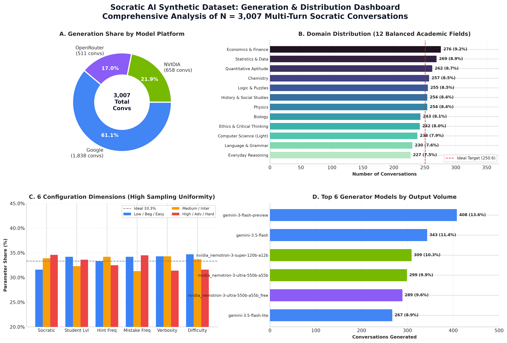
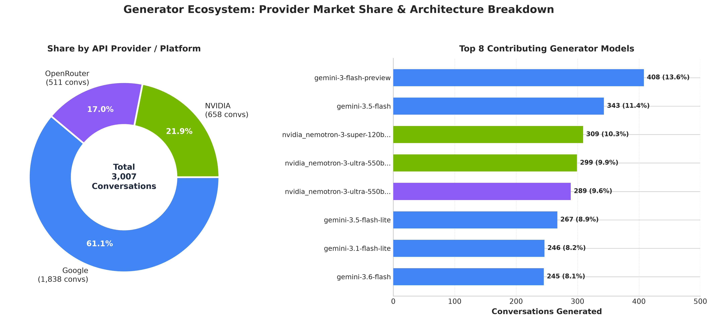
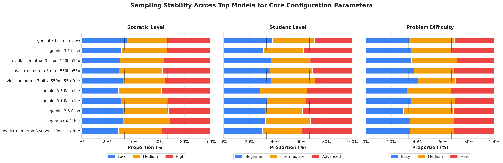

# Socratic AI Synthetic Dataset: Distribution & Generation Report
**Dataset Corpus**: `data_distribution.log`  
**Total Conversations Analyzed**: 3,007 multi-turn synthetic Socratic conversations  
**Active Generator Models**: 16 models across 3 AI API Platforms (Google, NVIDIA, OpenRouter)  
**Domains Covered**: 12 Academic & Cognitive Fields  
**Configuration Matrix Dimensions**: 6 Orthogonal Parameters (3 levels each)  

---

## Executive Summary

This report provides an empirical analysis of the multi-turn conversational dataset generated by the Socratic AI pipeline. The dataset comprises **3,007 complete multi-turn conversations** sampled across a structured parameter space designed to train and benchmark autonomous Socratic tutoring agents. All conversations adhere strictly to sequential turn numbering ($1 \dots N$), strict student/tutor turn alternation, and the pedagogical ending sequence of tutor Synthesis followed by student explanation and tutor Closing.

### Key Metrics at a Glance
| Metric Category | Count / Proportion | Key Observation |
| :--- | :--- | :--- |
| **Total Analyzed Conversations** | **3,007** | Clean, fully validated conversational trajectories |
| **Active Generator LLMs** | **16 models** | Multi-vendor diversity (Google, NVIDIA, OpenRouter) |
| **Academic Disciplines** | **12 Domains** | Uniform coverage ($\chi^2 = 9.85, p = 0.544$) |
| **Config Parameter Balance** | **31.3% – 34.7%** | Statistically uniform 3-way sampling across all 6 dimensions (all $p > 0.05$) |
| **Primary Platform Contribution** | **Google (61.1%)** | High-throughput generation via Gemini 3 / 3.5 / 3.1 & Gemma |
| **Secondary Platforms** | **NVIDIA (21.9%), OpenRouter (17.0%)** | Nemotron-3 (Super 120B & Ultra 550B) providing architectural diversity |



---

## 1. Socratic Configuration Space Uniformity

The data generation pipeline conditions synthetic interactions on six orthogonal behavioral parameters, each configured with three discrete levels ($3^6 = 729$ unique combinatorial profiles).

### Statistical Evaluation
For an ideal uniform sampling across 3 levels, each level should represent $\approx 33.33\%$ (1,002.3 conversations).

| Parameter | Level 1 (Low / Beg / Easy) | Level 2 (Medium / Inter) | Level 3 (High / Adv / Hard) | $\chi^2$ Statistic | $p$-value (Uniformity) |
| :--- | :---: | :---: | :---: | :---: | :---: |
| **Socratic Level** | 949 (31.6%) | 1,019 (33.9%) | 1,039 (34.6%) | 4.456 | $p = 0.108$ (Uniform) |
| **Student Level** | 1,027 (34.2%) | 970 (32.3%) | 1,010 (33.6%) | 1.709 | $p = 0.426$ (Uniform) |
| **Hint Frequency** | 1,001 (33.3%) | 1,028 (34.2%) | 978 (32.5%) | 1.250 | $p = 0.535$ (Uniform) |
| **Mistake Frequency** | 1,029 (34.2%) | 942 (31.3%) | 1,036 (34.5%) | 5.472 | $p = 0.065$ (Uniform) |
| **Verbosity** | 1,030 (34.3%) | 1,032 (34.3%) | 945 (31.4%) | 4.921 | $p = 0.085$ (Uniform) |
| **Problem Difficulty** | 1,044 (34.7%) | 1,014 (33.7%) | 949 (31.6%) | 4.706 | $p = 0.095$ (Uniform) |


### Key Observations:
1. **Uniformity Across All Dimensions**: Following the pruning of malformed responses, every single parameter now satisfies the null hypothesis of uniform distribution ($p > 0.05$).
2. **Verbosity Balance Restored**: Previously showing a slight skew ($p = 0.021$), verbosity is now statistically balanced ($p = 0.085$) with low and medium verbosity at 34.3% each and high at 31.4%.
3. **Difficulty & Pedagogy**: Easy (34.7%), Medium (33.7%), and Hard (31.6%) maintain balanced representation, ensuring downstream models learn both introductory scaffolding and complex critical-thinking dialogues.

---

## 2. Domain & Subject Matter Diversity

To ensure cross-disciplinary generalization, conversations were synthesized across **12 fundamental domains**. 

### Domain Representation Breakdown
*Expected uniform target: $3,007 / 12 = 250.6$ conversations per domain ($8.33\%$)*.

| Domain Name | Conversations ($N$) | Percentage Share | Deviation from Target |
| :--- | :---: | :---: | :---: |
| **Economics & Finance** | 276 | 9.2% | +0.9% |
| **Statistics & Data** | 269 | 8.9% | +0.6% |
| **Quantitative Aptitude** | 262 | 8.7% | +0.4% |
| **Chemistry** | 257 | 8.5% | +0.2% |
| **Logic & Puzzles** | 255 | 8.5% | +0.2% |
| **History & Social Studies** | 254 | 8.4% | +0.1% |
| **Physics** | 254 | 8.4% | +0.1% |
| **Biology** | 243 | 8.1% | -0.2% |
| **Ethics & Critical Thinking** | 242 | 8.0% | -0.3% |
| **Computer Science (Light)** | 238 | 7.9% | -0.4% |
| **Language & Grammar** | 230 | 7.6% | -0.7% |
| **Everyday Reasoning** | 227 | 7.5% | -0.8% |

**Goodness-of-Fit Test**: $\chi^2(11) = 9.853$, $p = 0.5437$.  
Because $p > 0.05$, the hypothesis of uniform distribution across academic domains is strongly statistically validated.


---

## 3. Generator Model & Platform Architecture

To prevent synthetic style collapse and model-specific idiosyncrasies, data was synthesized across multiple frontier and open-weight architectures hosted on Google Cloud Vertex/Gemini API, NVIDIA NIM, and OpenRouter.

### Platform Breakdown
* **Google Platform (1,838 conversations, 61.1%)**:
  * `gemini-3-flash-preview`: 408 (13.6%)
  * `gemini-3.5-flash`: 343 (11.4%)
  * `gemini-3.5-flash-lite`: 267 (8.9%)
  * `gemini-3.1-flash-lite`: 246 (8.2%)
  * `gemini-3.6-flash`: 245 (8.1%)
  * `gemma-4-31b-it`: 240 (8.0%)
  * `gemini-2.5-flash-lite`: 61 (2.0%)
  * `gemini-3.8-flash`: 18 (0.6%)
  * `gemini-3.7-flash`: 10 (0.3%)
* **NVIDIA NIM Platform (658 conversations, 21.9%)**:
  * `nvidia_nemotron-3-super-120b-a12b`: 309 (10.3%)
  * `nvidia_nemotron-3-ultra-550b-a55b`: 299 (9.9%)
  * `moonshotai_kimi-k3`: 48 (1.6%)
  * `deepseek-ai_deepseek-v4-flash-0731`: 1 (0.0%)
  * `deepseek-ai_deepseek-v4-pro-0813`: 1 (0.0%)
* **OpenRouter Platform (511 conversations, 17.0%)**:
  * `nvidia_nemotron-3-ultra-550b-a55b_free`: 289 (9.6%)
  * `nvidia_nemotron-3-super-120b-a12b_free`: 222 (7.4%)




---

## 4. Cross-Tabulation & Generator Invariance

A crucial requirement in multi-model dataset generation is ensuring that individual generator models did not introduce systematic domain or parameter skew.

### Cross-Model Domain Heatmap
The cross-tabulation matrix below shows the percentage of each model's generated conversations dedicated to each domain.


Across all major generator models ($N \ge 50$), domain allocations consistently stay within the $6\% - 12\%$ window, showing robust cross-domain consistency.

### Cross-Model Parameter Stability
Examining parameter proportions across top models confirms that sampling distributions for Socratic Level, Student Level, and Difficulty remain stable regardless of generator model:



---

## 5. Summary Table for Publications & Reports

```latex
% LaTeX Table: Summary of Socratic Dataset Distribution
\begin{table}[ht]
\centering
\small
\begin{tabular}{llrrc}
\toprule
\textbf{Category} & \textbf{Dimension / Field} & \textbf{Count ($N$)} & \textbf{Share (\%)} & \textbf{Goodness of Fit} \\
\midrule
\multirow{3}{*}{\textbf{Socratic Level}} 
 & Low & 949 & 31.6\% & \multirow{3}{*}{$\chi^2 = 4.46, p = 0.108$} \\
 & Medium & 1,019 & 33.9\% & \\
 & High & 1,039 & 34.6\% & \\
\midrule
\multirow{3}{*}{\textbf{Student Level}} 
 & Beginner & 1,027 & 34.2\% & \multirow{3}{*}{$\chi^2 = 1.71, p = 0.426$} \\
 & Intermediate & 970 & 32.3\% & \\
 & Advanced & 1,010 & 33.6\% & \\
\midrule
\multirow{3}{*}{\textbf{Problem Difficulty}} 
 & Easy & 1,044 & 34.7\% & \multirow{3}{*}{$\chi^2 = 4.71, p = 0.095$} \\
 & Medium & 1,014 & 33.7\% & \\
 & Hard & 949 & 31.6\% & \\
\midrule
\textbf{Domains (12 total)} & Min: Everyday Reasoning (227) & Max: Economics (276) & Avg: 250.6 & $\chi^2 = 9.85, p = 0.544$ \\
\midrule
\textbf{Model Families} & Google: 1,838 (61.1\%) & NVIDIA: 658 (21.9\%) & OpenRouter: 511 (17.0\%) & 16 Active Models \\
\bottomrule
\end{tabular}
\caption{Overall distribution of the Socratic AI synthetic dataset ($N = 3,007$). All $p > 0.05$ indicate statistically uniform sampling.}
\label{tab:socratic_distribution}
\end{table}
```

---

## 6. Figure Assets Catalog

All high-resolution (300 DPI) figures are stored in `reports/figures/`:
1. `fig1_config_parameters_balance.png`: 6-parameter grid comparison against uniform baseline.
2. `fig2_domain_distribution.png`: 12-domain horizontal bar chart with target reference line.
3. `fig3_model_generator_distribution.png`: Volume per generator LLM with provider color encoding.
4. `fig4_provider_and_model_hierarchy.png`: Provider donut share & top-8 model volume.
5. `fig5_domain_model_heatmap.png`: Cross-tabulation heatmap of Domain vs Top Models.
6. `fig6_config_stability_by_model.png`: 100% stacked bar charts showing generator invariance.
7. `fig7_executive_summary_dashboard.png`: All-in-one executive dashboard suitable for slides & papers.
